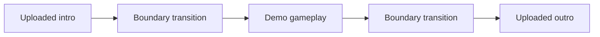

# Worked example and provenance

## ClipHub #201: concise body with a pipeline visual

This is an editorial rewrite based on the published [ClipHub #201 body](https://github.com/rechedev9/cliphub/pull/201), read on 2026-09-22. Its tests and observations are author-reported historical evidence, not checks performed while creating this skill. The conceptual diagram describes only the bumper transitions discussed in that body; it is not the complete timeline. Before publishing an equivalent rewrite, inspect the actual current diff and confirm the evidence and links for that revision.

Suggested title: `feat(full-demo): upload intro/outro MP4s directly and transition into gameplay`

---

## What Problem This Solves

Adding an intro or outro required a checkbox and a multi-field form, and the cuts between those clips and gameplay did not receive transitions.

## User Impact

Users can upload, preview, replace and remove an MP4 directly in each slot. Intro and outro cuts receive the dynamic transition even when round effects are disabled.

## Why This Change Was Made

Direct media cards simplify clip selection, while bumper transitions are controlled separately from round effects. Failed replacements retain the selected clip, and saved drafts restore both slots.

Conceptual flow when both optional clips are present; gameplay is abbreviated:

Embedded clip audio and exact frame/sample counts are preserved. Older bumper render caches are invalidated so the new transitions are rendered.

## Evidence

The original PR reports:

- Web production build and targeted lint passed; 46 Full Demo plan/client tests and 2 metadata endpoint tests passed.
- All 23 browser tests passed, covering upload, replacement failures, persistence, keyboard focus and responsive layouts at 390, 1024 and 1440 px.
- Focused Go planner, editor and render-cache regressions passed.
- A synthetic FFmpeg render verified clip order, visible transitions, preserved intro audio, silent outro audio, exactly 180 frames and 144,000 stereo audio samples.

The [PR screenshots](https://github.com/rechedev9/cliphub/pull/201) were captured from the compiled UI with fixture data and a synthetic MP4 preview. This evidence covers that setup, not an installed-app or real-demo run.

Browser fixture correction

The blocked-storage fixture now advances the mocked job to recording and waits for reconciliation before checking that only one request was sent. The original PR reports reproducing the former fixture's repeat-generation failure on the pre-redesign commit.

## Merge Danger

**Door:** one-way

A revert restores the previous upload UI and transition policy but does not change videos already rendered.

**Blast Radius:** shared

Full Demo intro/outro uploads, saved clip restoration and bumper rendering. The transition helpers are also used by round effects, so a regression could affect cuts or audio outside the new upload UI.

**Rollback:** Revert the UI and renderer changes together, check draft and render-cache compatibility, and regenerate affected outputs. Inspected, not exercised.

---

## Sources and design choices

Read on 2026-09-22. These are writing references, not assertions about future repository policies.

- [Dex Horthy / Humanlayer's show-me](https://github.com/humanlayer/skills/blob/main/plugins/show-me/skills/show-me/SKILL.md): the small explanatory visual, before/after evidence and the one-way/two-way door.
- [OpenClaw PR template](https://github.com/openclaw/openclaw/blob/main/.github/pull_request_template.md), blob `5b1eedd63c4b5eb2fc50a7ebdc4b977e5d97561c`: the four default headings and the product-centered narrative.
- [OpenClaw #141449](https://github.com/openclaw/openclaw/pull/141449) and [#141456](https://github.com/openclaw/openclaw/pull/141456): useful examples of failure/repair evidence, operational impact and optional detailed proof. [#141459](https://github.com/openclaw/openclaw/pull/141459) distinguishes browser evidence from deployment.
- [ClipHub #198](https://github.com/rechedev9/cliphub/pull/198), [#199](https://github.com/rechedev9/cliphub/pull/199), [#200](https://github.com/rechedev9/cliphub/pull/200) and [#201](https://github.com/rechedev9/cliphub/pull/201): motivated concise summaries with retained benchmark limits, real versus synthetic rendering evidence, and diagrams for nontrivial media flows.
- [Gravity Room #149](https://github.com/rechedev9/gravity-room/pull/149), [#150](https://github.com/rechedev9/gravity-room/pull/150) and [#151](https://github.com/rechedev9/gravity-room/pull/151): motivated explicit mobile environments, observed storage behavior and pending-check accuracy.

The adaptation keeps OpenClaw's body structure, adds a visual only where it helps, and closes with `Merge Danger`; small changes keep it brief.
